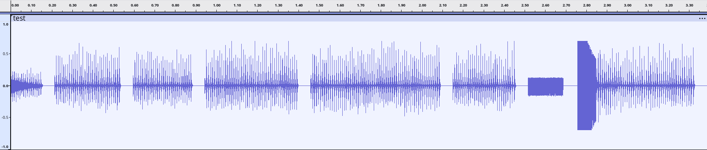
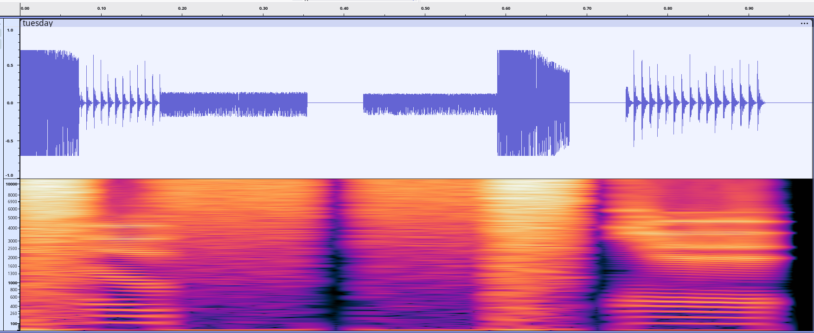

# TOM: Talking Output Machine for Text Synthesis

This project is a standalone text-to-speech (TTS) engine written from scratch in pure C. TOM aims to produce rules-based, intelligible robotic human speech entirely from mathematical time-domain models.

TOM is developed and tested under **Debian 13 Trixie** and is licensed under **GPL-3.0**. The long-term project roadmap is to refine TOM's voice clarity to integrate as a lightweight, flexible date-and-time announcer subsystem for the [**Talk Calendar**](https://github.com) project.

## System Architecture

**TOM operates entirely within the time domain**.

### 1. Application (`src/main.c`)

Acts as the command-line interface (CLI) entry point. It processes initial arguments, handles option flags, converts text strings to mandatory uppercase formatting, and routes translated phonetic arrays to the layout scheduler. It features an expanded `MAX_AUDIO_SAMPLES` canvas of **524,288 bytes** to handle complex sentences safely without stack overruns, using a native `WriteWav` utility to package raw unsigned 8-bit PCM vectors.

Processing chain:
```
main.c → translate_word_phrase() → syllabify_phonemes() → schedule_phoneme_frames() → generate_speech_wave()
```

### 2. ARPAbet Phonetic Dictionary (`src/dictionary.h`)

Maps literal text input terms (days of the week, months, numbers, words) directly into continuous, standardized space-separated **ARPAbet phonetic strings** featuring explicit numerical stress accents (e.g., `"32"` → `"TH ER1 D IY0 T UW1"`).

The dictionary includes:
- Days of the week with their phonetic pronunciations
- Months of the year with full phonetic transcriptions  
- Ordinal numbers (1st, 2nd, etc.) with stress markings
- Cardinal numbers from 1 to 59 with proper stress patterns
- Common words like "THE", "TIME", "AM", "PM"
- Special terms for calendar events: "HAPPY", "BIRTHDAY", "MEETING", "DENTIST", "DOCTOR", "APPOINTMENT", "REMINDER", "HOLIDAY", "WORK"
- Words for greeting and identification: "WORLD", "HELLO", "MY", "NAME", "IS", "TOM"

### 3. Speech Frame Scheduler (`src/scheduler.c`)

The scheduler processes ARPAbet phonetic strings to generate speech frames that define the acoustic characteristics of each phoneme over time.

#### Data Structures Used:
```c
typedef struct {
    uint16_t frequency;  
    uint16_t amplitude;
    uint16_t bandwidth;   // Added bandwidth field for formant shaping
} Formant;

typedef struct {
    Formant f1;
    Formant f2;
    Formant f3;
    Formant f4;
    Formant f5;
    Formant f6;
    uint16_t pitch;
    uint16_t type;      // Hardcoded to an explicit 16-bit width to crush compiling pointer shifts!
} SpeechFrame;

typedef struct {
    unsigned char speed;
    unsigned char pitch;
    unsigned char mouth;
    unsigned char throat;
} SchedulerContext;
```

#### How it works:

1. **Input Processing**: Takes a space-separated phonetic string and removes bracket characters
2. **Phoneme Tokenization**: Splits input into individual phonemes using whitespace delimiters  
3. **Stress Detection**: Identifies stress markers (0, 1, or 2) in phoneme names to adjust duration
4. **Frame Generation**: For each phoneme:
   - Determines base duration based on phoneme type (vowels = longer, consonants = shorter)
   - Applies speed modifier from user settings 
   - Adjusts duration for stress levels and phonetic category
   - Generates multiple frames with interpolation to create smooth transitions

#### Frame Generation Details:

- **Duration Calculation**: Base durations are modified by speed setting and stress level
- **Interpolation**: Each frame uses a blend of current phoneme parameters and previous vowel history 
- **Vowel History Preservation**: When processing voiced vowels, the scheduler preserves their formant coordinates to bridge consonant gaps smoothly
- **Blending**: Frames at transition points use interpolation over 1/3 of the duration to prevent abrupt changes

### 4. Six-Formant Sine Wave Mixing Audio Engine (`src/wave_generator.c`)

This engine generates audio using a 6-formant mixed sine wave approach, creating realistic speech sounds by combining multiple sinusoidal oscillators.

#### Data Structures Used:
```c
typedef struct {
    uint16_t frequency;  
    uint16_t amplitude;
    uint16_t bandwidth;   // Added bandwidth field for formant shaping
} Formant;

typedef struct {
    Formant f1;
    Formant f2;
    Formant f3;
    Formant f4;
    Formant f5;
    Formant f6;
    uint16_t pitch;
    uint16_t type;      // Hardcoded to an explicit 16-bit width to crush compiling pointer shifts!
} SpeechFrame;

typedef struct {
    float ph0; 
    float ph1; float ph2; float ph3; float ph4; float ph5; float ph6;
    uint16_t noise_lfsr; 
} TOMEngineState;

typedef struct {
    float prev_f1_freq; float prev_f2_freq; float prev_f3_freq;
    float prev_f4_freq; float prev_f5_freq; float prev_f6_freq;
    float prev_f1_amp;  float prev_f2_amp;  float prev_f3_amp;
    float prev_f4_amp;  float prev_f5_amp;  float prev_f6_amp;
    int frame_valid;    float prev_mix_weight; 
} InterpolationState;
```

#### Key Features:

- **6-formant synthesis**: Uses 6 different frequency components for realistic speech
- **Bandwidth control**: Controls the sharpness of formant peaks  
- **Smooth transitions**: Prevents abrupt changes between phonemes
- **Noise handling**: Properly generates consonants with appropriate noise characteristics
- **Clipping prevention**: Multiple clamping mechanisms prevent audio distortion

#### Wave Generation Process:

1. **Formant Mixing**: Each speech frame contains 6 formants (f1-f6) that are mixed together using sine waves
2. **Noise Generation**: LFSR-based noise is used for unvoiced consonants and fricatives  
3. **Mix Weight Control**: Smoothly transitions between voiced and unvoiced components based on phonetic characteristics
4. **Amplitude Normalization Filter**: dynamic master peak/RMS normalization Automatic Gain Controller (AGC) to prevent clipping across all complex phoneme junctions (likeconsonant strings in "Wednesday" or "Tuesday")

#### Key Algorithms:

**Amplitude and Frequency Interpolation:**
- **Frequency Interpolation**: Smooths transitions between different formants to prevent clicking artifacts
- **Amplitude Interpolation**: Reduces amplitude jumps that could cause audible distortion  
- **Interpolation Factors**: Controlled via `FREQUENCY_INTERP_FACTOR` (0.10) and `AMPLITUDE_INTERP_FACTOR` (0.05)
- **Clipping Parameters**: Prevents extreme amplitude values that could cause clipping

**Intonation Factor & Adjusted Pitch:**

The intonation factor creates natural-sounding pitch variations by gradually decreasing the pitch over time:
```c
float intonation_factor = 1.0f - ((float)f / (float)frame_count) * 0.12f;
float adjusted_pitch = (float)current_frame->pitch * intonation_factor;
```
This creates a subtle downward pitch contour that mimics natural speech patterns.
The `adjusted_pitch` parameter modifies the fundamental frequency of each frame:
- For voiced phonemes, it's scaled by the intonation factor
- For unvoiced phonemes, it maintains consistency with formant characteristics  
- Sample rate calculation uses this adjusted pitch to determine how many samples represent one cycle

### 5. Phoneme Database (`src/lookup_tables.h`)

Contains the complete phoneme database with formant frequencies (f0-f6), bandwidths (bw1-bw6), amplitudes (a1-a6) needed for 6-formant speech synthesis.

#### Data Structure:
```c
typedef struct {
    const char *name;
    uint16_t f1_hz;     // True physical targets in Hertz
    uint16_t f2_hz; 
    uint16_t f3_hz; 
    uint16_t f4_hz;
    uint16_t f5_hz;
    uint16_t f6_hz;
    uint8_t a1;         // Relative amplitude coefficients (0-15 scale)
    uint8_t a2;
    uint8_t a3;
    uint8_t a4;
    uint8_t a5;
    uint8_t a6;
    uint16_t b1;         // Bandwidths for formants
    uint16_t b2;
    uint16_t b3;
    uint16_t b4;
    uint16_t b5;
    uint16_t b6;
    uint8_t flags;      // Category assignment tag
} PhonemeDescriptor;

// Explicit phonetic category tags matching your math-driven architecture
#define PH_VOICED   0x00  // Vowels, Liquids, Nasals (sinf multi-oscillator track)
#define PH_NOISE    0x01  // Fricatives, Plosives, Stops (LFSR random burst track)
#define PH_SILENCE  0x02  // Absolute quiet padding windows
```

#### Phoneme Categories:

- **PH_VOICED**: Vowels, liquids, and nasals that produce voiced sounds with periodic glottal pulses
- **PH_NOISE**: Fricatives, plosives, and stops that generate noise-based sounds without periodicity  
- **PH_SILENCE**: Complete silence periods used for pauses between words

#### Formant Characteristics:

Each phoneme contains 6 formant frequencies (f1-f6) with associated amplitudes (a1-a6) and bandwidths (b1-b6). These parameters define how the vocal tract shapes sound waves to produce specific speech sounds.

Bandwidths control the sharpness of formant peaks. Smaller bandwidths create sharper, more focused peaks (like vowels), while larger bandwidths create broader, softer peaks (like consonants).

## Subsystem Architectural Layout

```text
tom/
├── Makefile
└── src/
    ├── main.c              (CLI entry point, option processing, buffer arrays & file IO)
    ├── dictionary.h        (ARPAbet transcription lists to pronounce words)
    ├── scheduler.h         (Forward declarations for timeline scheduling)
    ├── scheduler.c         (ARPAbet string parser with stress to produce speech frames)
    ├── wave_generator.h    (Formant, SpeechFrame structures and forward declarations for wave generation)
    ├── wave_generator.c    (Sine wave mixing audio engine)
    └── lookup_tables.h     (Phoneme database with formant frequencies (f0-f6), bandwidths (bw1-bw6), amplitudes (a1-a6)  needed for 6-formant speech synthesis)
```

## Installation & Build Instructions

Compile the codebase using a terminal environment:

```bash
# 1. Clear out previous object files and compile fresh binaries
make clean
make

# 2. Verify the Talking Output Machine working by saying "hello world"
./tom "hello world" -speed 72 -pitch 112 -av 1.5 -wav test.wav && aplay test.wav
```

### CLI Switch Options
You can alter expression, pacing, and intonation parameters using command-line arguments:

* `-wav [filename]` : Directs output vectors straight into a clean WAV file.

* `-pitch [value]`   : Overrides baseline fundamental glottal clock pitch (Default = 64).

* `-speed [value]`   : Compresses or expands frame duration timelines (Default = 72).

* `-av [value]`   :  volume control (Default =1.0).

* `v`   : TOM version number

## Testing

## Speak "Hello my name is Tom"

Pitch and speed are crucial in speech synthesis as they affect the tone and clarity of the speech output. You can adjusting these parameters using the -pitch and -speed parameters as shown below.

```
./tom "hello my name is Tom" -speed 72 -pitch 112 -av 1.5 -wav test.wav && aplay test.wav
Input: hello my name is Tom
Speed: 72, Pitch: 112, Volume Factor: 1.50
Phonetic output (raw): HH AH0 L OW1 SIL M AY1 SIL N EY1 M SIL IH1 Z SIL T AA1 M SIL 
Phonetic output (syllabified): HH SIL AH0 L SIL OW1 SIL M AY1 SIL N EY1 M SIL IH1 SIL Z SIL T AA1 M SIL
DEBUG: Generating 342 frames
TOM: Synthesized audio written safely to 'test.wav'.
Playing WAVE 'test.wav' : Unsigned 8 bit, Rate 22050 Hz, Mono
```

A screenshot of the waveform produced from the "hello my name is Tom" test  is shown below.




## Speak "Tuesday"

Tuesday is a difficult word to pronounce. There is  a brief closure, then a short burst of noise followed by voiced vowel, with regular, periodic waveform cycles then a voiced fricative typically noisy then a voiced stop. Finally there is a voiced diphthong. Below shows the test for speaking Tuesday.

```
./tom "tuesday" -speed 72 -pitch 112 -av 1.5 -wav tuesday.wav && aplay tuesday.wav
Input: tuesday
Speed: 72, Pitch: 112, Volume Factor: 1.50
Phonetic output (raw): T UW1 Z D EY0 SIL 
Phonetic output (syllabified): T UW1 SIL Z D SIL EY0 SIL
DEBUG: Generating 98 frames
TOM: Synthesized audio written safely to 'tuesday.wav'.
Playing WAVE 'tuesday.wav' : Unsigned 8 bit, Rate 22050 Hz, Mono

```
A screenshot of the Tuesday waveform plus the spectrogram is shown below.



The **Waveform (top):** shows how the signal’s amplitude changes over time. Large excursions mean stronger sound; a flat or nearly flat stretch means silence or very quiet sound. The *shape* of a block shows its amplitude envelope. The **Spectrogram (bottom):** shows how energy is distributed across time and frequency. Brighter colors mean more energy at those frequencies.  A dark spectrogram region  means very quiet audio but not necessarily absolute digital silence. The spectrogram’s colors show relative energy. The horizontal pattern and its persistence are more informative than whether a patch is a particular colour.

The ARPAbet pronunciation of Tuesday with syllables isroughly **T UW Z | D EY** (“Tues-day”). The sounds are:

- **T**: voiceless stop. There’s usually a brief closure, then a short burst of noise (represented by TOM as an exponentially decaying block of sound)
- **UW**: voiced vowel, with regular, periodic waveform cycles.
- **Z**: voiced fricative—typically noisy (represented by TOM as the solid block of sound)
- **D**: voiced stop. It has a closure and release, though it can blend with the preceding `Z` (represented by the decaying exponential)
- **EY**: voiced diphthong, with periodic cycles whose resonance changes as the tongue moves.

The EY is a voiced vowel sound and appears as a fairly continuous, regularly repeating shaped waveform, unlike the brief burst of a stop or the noisy texture of the fricative Z. The **T** in *Tuesday* has a brief aspiration after its release. The **D** blends with with the preceding `Z`.

TOM places a '[SIL]' at the syllable boundary between `Z` and `D` The waveform above  shows two stronger voiced-looking regions which is what you would expect to broadly fit a two-syllable word. In **day** (`D EY`), the `D` is a stop, followed by the vowel `EY`. The vowel is a **diphthong**, so its sound changes as you say it.

The spectrogram can be thought of as a **heat map of the sound**:

- **Left to right:** time
- **Bottom to top:** frequency, from low to high
- **Bright colors:** stronger sound energy; dark colors: weaker energy

In the spectrogram for Tuesday the dark regions correspond to pauses in the audio (silence regions). The display also makes the sound’s bursts and decays easier to locate in time.

For **Tuesday** (`T UW Z D EY`), vowels such as `UW` and `EY` show regular horizontal stripes from vocal-fold vibration.  The brighter regions and horizontal striping show voiced, resonant sound; the darker vertical bands show brief drops in energy. In the waveform section where there is a solid block of low-amplitude sound before about 0.60s and then a sudden increase in amplitude, followed by a roughly 75 ms decay the spectrogram shows a yellow strip indicating more energy in that part of the frequency range than the neighbouring orange areas. In a spectrogram, time runs left to right and frequency runs bottom to top; a horizontal stripe means energy in that frequency range continues over time. 

The section representing the voiced vowel in “day”  shows a waveform consisting of a a sequence of regularly spaced pulses. These repeated pulses indicate periodic vibration—voicing. In the spectrogram, the sound after onset has sustained horizontal structure: fine horizontal bands reflect harmonics from that voicing, while the broader bright bands show frequency ranges where the vowel has stronger resonance. That pattern is consistent with a vowel such as the EY in “day.” The signal gradually weakens toward the right edge.

## Future Work 

The current code base has focused on the audio engine to create a synthesised robot voice. The ARPAbet phonetic dictionary only contains a small number of words based around reading out calendar dates and times for testing purposes. This needs to be expanded. The TOM synthesizer also needs a punctuation pre-processing loop to parse literal string punctuation signs (`,` or `.`) and translate them automatically into precise, rhythmically timed `SIL` frame intervals. A longer term goal would be a function to convert words into their ARPAbet phoneme sequences with stress (a G2P engine). Speaking a complex calendar phrase sentence with expressive pacing require further work on the intonation parameters to produce more natural sentence cadence.

The TOM audio engine is based around mixing sine wave for the 6 formants (f1-f6). LFSR-based noise is used for unvoiced consonants and fricatives. Most main stream speech synthesizers such as espeak use Klatt formant synthesis as a back end speech synthesizer. Other open source speech synthesizers like Flite use diphone concatenation (e.g. splicing together transitions between sounds). Because TOM uses a simpler lightweight  sine wave mixing approach the speech audio produced sounds like a speech synthesizer from the 1980's. I need to experiment with algorithms which control speed, pitch, mouth and throat parameters to see if I can achieve audio quality and clarity approaching espeak and Flite.

## Author

* **Alan Crispin** [Github](https://github.com/crispinprojects)

## Project Status

Under development.

## Acknowledgements

* [Peterson and Barney (1952) formant frequency database](https://www.cs.cmu.edu/Groups/AI/areas/speech/database/pb/0.html)

* [ARPAbet transcription of words](https://en.wikipedia.org/wiki/ARPABET )

* [The CMU Pronouncing Dictionary](http://www.speech.cs.cmu.edu/cgi-bin/cmudict)
 
* [Speech Synthesis](https://en.wikipedia.org/wiki/Speech_synthesis)

* [Speech coding](https://en.wikipedia.org/wiki/Speech_coding)

* [Formant Synthesis Models](https://ccrma.stanford.edu/~jos/pasp/Formant_Synthesis_Models.html)

* [espeak](https://espeak.sourceforge.net/)  *Author:* Jonathan Duddington

* [Klatt Software Speech Synthesizer](https://github.com/rhdunn/klatt) GPL Re-implementation  *Author:* Reece H. Dunn

* [Speech Synthesis](https://www.youtube.com/watch?v=eDjtEsOvouM&t=1459s) CMU Low resource NLP Bootcamp 2020  *Author:* Professor Alan W Black 

